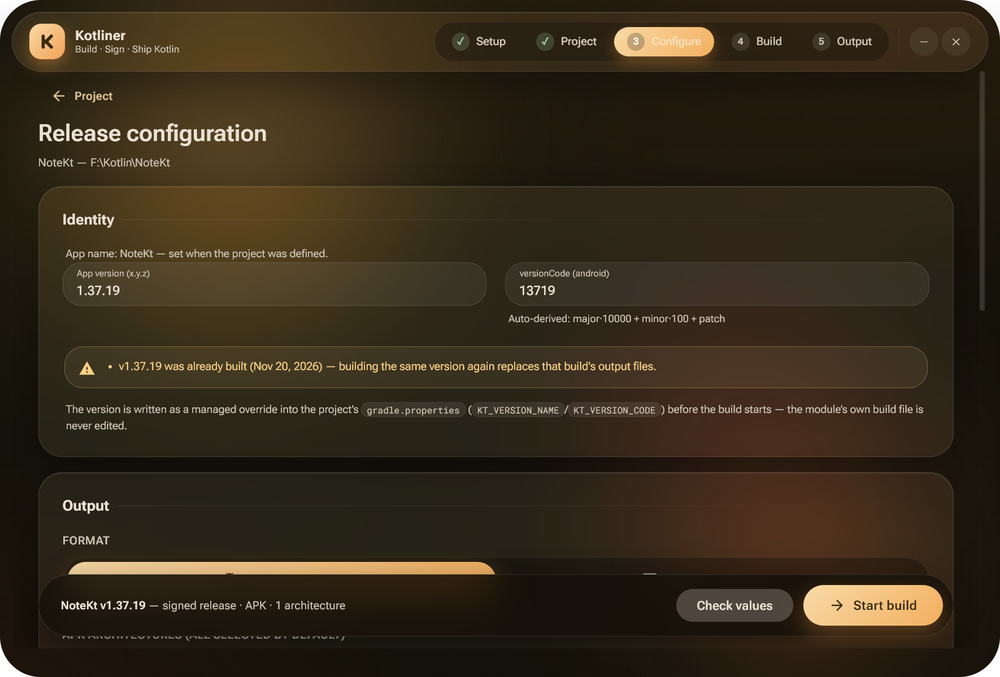

# Kotliner

A local Material 3 Expressive desktop app (Electron) that builds and signs **any Kotlin Android (Gradle) project** on Windows — APK (per-ABI splits) or AAB — without touching your project's own build files. Plain single-module projects, multi-module projects and **Compose Multiplatform / KMP** projects (plugin applied through a version-catalog alias, SDK levels read from the catalog) all work.



## Download

Build the installer yourself: `npm install && npm run dist` → `dist/Kotliner Setup 1.0.0.exe`. The app itself checks all build prerequisites on first launch.

## Run it

```bash
npm install
npm start
```

The app is written in **TypeScript** (strict mode). `npm start` compiles everything first: main-process sources → `out/`, renderer sources (`renderer/src/`) → `renderer/assets/`, dev scripts in place. Compiled output is gitignored — the build step is always part of `start`/`smoke`/`dist`.

Requirements on the machine (same as building by hand) — the app **checks all of them itself** on the first page:

- **Git for Windows** (bash + MSYS tools) — the build script runs through Git Bash
- **JDK 17+** with `java` + `keytool` (`JAVA_HOME`, PATH, or Android Studio's bundled JDK)
- **Android SDK** (`ANDROID_HOME` / `ANDROID_SDK_ROOT` / `%LOCALAPPDATA%\Android\Sdk`) with **platform-tools**, **build-tools** and an **Android platform** (the **NDK** and **CMake** are optional — only projects with native C/C++ code need them)

## The flow

0. **Setup (environment gate)** — the app opens on a dependency check, not the picker. It probes the machine (read-only, nothing is installed): Git Bash, the JDK (version + `keytool`), the Android SDK root and inside it platform-tools (`adb`), build-tools (`aapt`/`apksigner`/`zipalign`), the newest platform, and optionally the NDK and CMake. Each row shows the detected version/path — or what to install and where — with **Continue locked until every required tool is found**; missing optional tools only turn the row gray. A *Check again* button re-runs everything after you install something.
   - **Newer-version detection & one-click update** — rows with a newer stable release get a **version chip** (`↑ 21.0.12`): Google's Android SDK repository manifest (`repository2-*.xml`, with `sdkmanager --list` as fallback) for SDK components, adoptium.net for **Temurin JDK 21 LTS**, and github.com (git-for-windows) for **Git Bash**. Clicking a chip opens a detail dialog with an **Update now** button — SDK components install through `sdkmanager` (or directly from the repository manifest on mirrors), JDK/Git download their official installer into Downloads. Offline, detection degrades gracefully.
   - **One-click install of missing dependencies** — required rows that are not found get a green install chip; the **Android SDK row** bootstraps a complete SDK (command-line tools + every required component) into a folder you pick (default `%LOCALAPPDATA%\Android\Sdk`, remembered).
   - **Download source selector** — Google (official) by default, **Tencent Cloud — China** full mirror, or any **custom base URL** serving `repository2-3.xml`; the choice is persisted app-wide and drives every SDK download (SHA-1-verified).
1. **Project** — pick a folder with the native Windows directory picker. The app validates it is a Kotlin Android project (`settings.gradle(.kts)` + a module applying `com.android.application`), parses `rootProject.name`, `applicationId`, `versionName`/`versionCode` and the SDK levels, then asks you to **name the project**. Every defined project is remembered in a **"Your projects" list**; each project keeps a **build history** (version, format, signing, status, duration, files) with a details dialog per build.
2. **Configure**
   - **App version** — prefilled from the module's `versionName`, auto-derived `versionCode` (`major·10000 + minor·100 + patch`, editable). The version is written as a **managed override**: `KT_VERSION_NAME`/`KT_VERSION_CODE` properties in `gradle.properties` plus a marked block in the app module's build file that re-assigns them inside `defaultConfig` — later assignments win, so **your own build file is never edited**.
   - **Version warnings** (from build history) — already-built versions warn that rebuilding replaces the outputs; lower versions warn that a lower versionCode can block updates. Rebuilding an already-built version asks for confirmation and recycles the old files to the **Recycle Bin**.
   - **Sign the app** — key alias, key password, keystore password (show/hide + built-in generator with strength meter) and a searchable 249-country picker for the certificate dname.
   - **Password vault** — credentials are saved **encrypted** (Electron `safeStorage` → Windows DPAPI, bound to the current Windows user) per project; reopening the project asks for **Windows Hello** (fingerprint / PIN / face) and autofills them behind a blurred *Confirm it's you* overlay. `AB_NO_HELLO=1` skips the prompt in tests/CI.
   - **Lost-password recovery** — when `keytool` rejects the passwords (`@@KEYFAIL`), a dialog offers **Archive old key & build** (renames `android-key/` to `android-key-old/`, numbered on collisions — nothing is deleted) and rebuilds with a fresh keystore.
   - **Google Play Console (optional)** — website-style **Sign in with Google** (PKCE + loopback redirect in the system browser), refresh token saved encrypted. After an AAB build, the Output page can **register the keystore as the app's Play upload key** via the Play Developer API (optionally attaching a draft Internal-testing release). Bake your own OAuth client with `npm run build && node tools/bake-oauth.js <client-id>`.
   - **Format** — APK (with per-ABI splits: arm64-v8a, armeabi-v7a, x86_64, x86 — all selected by default) or AAB.
   - **Advanced** — **Target Android SDK** pin (24–37) applied as a managed build-scoped property + block; `compileSdk` is raised automatically when the pin exceeds the module's declaration. Plus: redirect heavy Gradle output to `C:\KotlinerBuilds\<project>` via NTFS junctions (on by default).
3. **Build** — every command streams into the console line by line with phase tracking and elapsed time; cancel anytime (kills the whole bash→gradle→java tree). On failure the app offers a **debug-mode rerun** (`set -x` + `--stacktrace --info`).
4. **Output** — every produced APK/AAB plus `android-key.jks` with individual Save buttons, **Download ZIP** (outputs + keystore), and open-folder shortcuts. Finishing a build records it in the project's **build history**.

## Signing model

- The **`android-key/`** folder at the project root holds the persistent keystore (`android-key.jks`). If it exists it is **validated** against the alias/passwords (mismatch → `@@KEYFAIL` → recovery dialog) and reused; if not, a 2048-bit RSA / 10000-day key is generated once.
- A working copy is placed in the app module as `<Name>.v<version>.jks` and wired into `gradle.properties` (`MYAPP_UPLOAD_*`) + a generated signing block using a dedicated `ktUpload` signing config (never colliding with the project's own configs).
- If a project ships `scripts/verify-signing.sh`, it runs after an APK build.

## How the build works (resources/kotlin-build.sh)

Same marker protocol as its Expo-Builder ancestor — `@@PHASE` / `@@ARTIFACT` / `@@KEYSTORE` / `@@KEYFAIL` / `@@DONE` streamed from bash through the Electron main process:

`dependencies` (locate the Gradle wrapper / system gradle) → `prepare` (NTFS junctions) → `keystore` (keytool) → **gradle config** (build-scoped properties + a regenerated "Kotliner build block" appended to the app module's build file — Groovy **or** Kotlin DSL to match the project — wiring signing, ABI splits and the target-SDK pin) → `gradle` (`./gradlew :<module>:assembleRelease|bundleRelease --no-daemon`) → `collect` (rename + report artifacts) → `verify` (optional project hook) → `done`.

Every generated block/property set is **idempotent** — re-created on each run, never accumulating, and clearly marked so you can delete them.

### Compose Multiplatform / version-catalog projects

The Android application module is found even when `com.android.application` is applied through a **version-catalog alias** — `alias(libs.plugins.androidApplication)` in a `composeApp/` (or any) Kotlin-DSL module. Alias keys are resolved from `gradle/libs.versions.toml` (`[plugins]` entries whose `id` is `com.android.application`), with the common `libs.plugins.androidApplication` / `libs.plugins.android.application` spellings accepted even without a catalog. SDK levels declared as catalog references (`compileSdk = libs.versions.android.compileSdk.get().toInt()` — the standard KMP template style) are resolved the same way, both for the project card's prefill and for the target-SDK pin's compileSdk raise. All generated override blocks are emitted in **Kotlin DSL** for `.kts` modules and Groovy for `.gradle` ones.

## Project layout

```
main.ts                  Electron main (IPC, environment gate + version watch, build wiring, log streaming, zip, dialogs)
preload.ts               contextBridge API
lib/types.d.ts           shared ambient types (IPC payloads, build records…)
lib/project-info.ts      Gradle-project validation + managed version overrides (CLI: node out/lib/project-info.js <dir>)
lib/env-check.ts         dependency detection for the setup gate (CLI: node out/lib/env-check.js)
lib/sdk-updates.ts       newest-release detection for the deps page (CLI: node out/lib/sdk-updates.js)
lib/sdk-install.ts       install actions: sdkmanager installs + direct-from-manifest downloads (SHA-1, extraction) + installers
lib/mirrors.ts           download-source registry (Google / Tencent / custom base URL)
lib/net.ts               HTTP fetch with dual-stack retry (proxy/PAC honored)
lib/play-console.ts      Google OAuth (PKCE + loopback sign-in) + Play Developer API upload-key registration
resources/kotlin-build.sh  generalized build script (env-driven, @@PHASE/@@ARTIFACT markers)
resources/verify-hello.ps1 Windows Hello consent (UserConsentVerifier)
renderer/                UI — hand-rolled Material 3 Expressive dark amber glass theme
  index.html
  assets/m3.css          design tokens + components (buttons, fields, chips, dialogs…)
  assets/app.css         page layout
  src/app.ts             5-page flow (setup → project → configure → build → output)
  src/countries.ts       ISO 3166 country data
tools/make-icons.ts      icon generator (npm run icons)
tools/bake-oauth.ts      bakes the Google OAuth client ID into main.ts (encoded)
.smoke/*.ts              QA harnesses, compiled in place by the build
```

## Testing

```bash
npm run smoke          # boots the app, walks all pages with mock data, screenshots into .smoke/
bash .smoke/make-fake.sh   # builds the throwaway fake Kotlin projects (app/ + Compose Multiplatform fixtures) + gradlew shims + test keystore

# full in-app end-to-end against the fake projects (no real gradle needed):
E2E_PROJECT="F:/Kotliner/.smoke/fake-project" AB_NO_HELLO=1 npx electron . --e2e
E2E_PROJECT="F:/Kotliner/.smoke/fake-project" E2E_EXPECT_FAIL=1 FAIL_SHIM=1 AB_NO_HELLO=1 npx electron . --e2e
E2E_PROJECT="F:/Kotliner/.smoke/fake-project" E2E_KEYFAIL=1 AB_NO_HELLO=1 npx electron . --e2e
# same flows against the Compose Multiplatform fixture (alias plugins, catalog refs, .kts):
E2E_PROJECT="F:/Kotliner/.smoke/fake-kmp" AB_NO_HELLO=1 npx electron . --e2e

# page-1 naming flow:                npm run verify:naming
# every input/combobox:              npm run verify:inputs
# build history + warnings:          npm run verify:history
# encrypted password vault:          AB_NO_HELLO=1 npm run verify:vault

node out/lib/project-info.js "F:/Some Kotlin Android Project"   # validate a folder from CLI
node out/lib/env-check.js                                       # dependency checks from CLI (JSON)
```

## Notes

- Passwords never leave the machine: they go into the `keytool` command and the project's `gradle.properties` only.
- All version/signing overrides are build-scoped and re-created every run — the project's own Gradle files are never modified.
- Projects without a Gradle wrapper fall back to a system `gradle` (the project card warns about it).
- Icons: `npm run icons` regenerates `resources/icon.{ico,png,svg}` from the amber "K" monogram.
